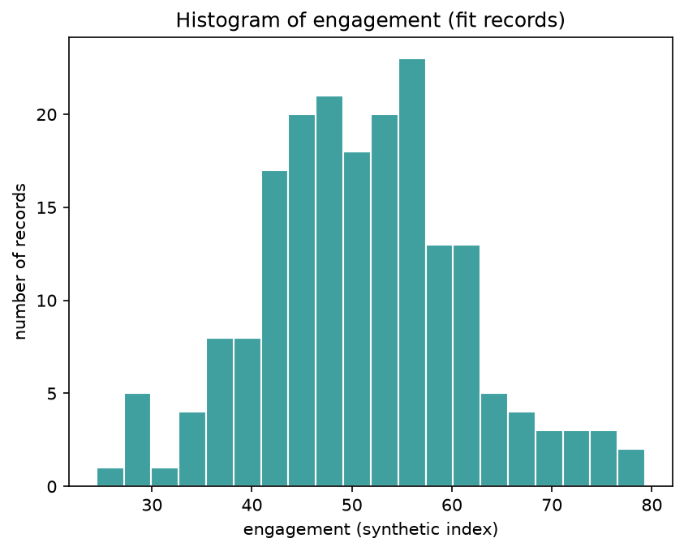
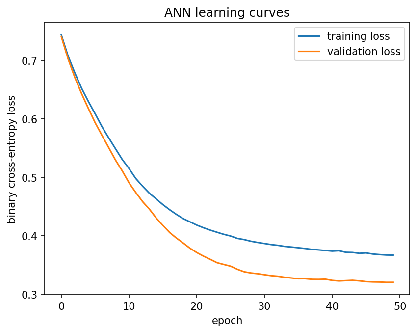

# 📊 Campaign Response Prediction — Set A

**Data Science & AI/ML Practical Exam** · End-to-end pipeline predicting whether a customer responds to a marketing campaign, with audience segmentation and a full model comparison (Baseline → Logistic Regression → ANN).


---

## 🎬 Video Walkthrough

<div align="center">

[](https://drive.google.com/file/d/1CZlv6WK_BTNo6FV4MVIxxmi502dkfA2v/view?usp=sharing)

> 🎥 **A complete end-to-end video explanation** of this Data Science & AI/ML project — covering the raw data audit and de-duplication, the stratified fit/validation/test split, descriptive & inferential statistics on customer engagement, leakage-safe preprocessing and feature engineering, the baseline vs. logistic regression comparison for predicting campaign response, K-Means customer segmentation, and the final ANN build with early stopping.

> 📌 *Click the button above or [open the video directly →](https://drive.google.com/file/d/1CZlv6WK_BTNo6FV4MVIxxmi502dkfA2v/view?usp=sharing)*

</div>

---

## 📑 Table of Contents

- [Video Walkthrough](#-video-walkthrough)
- [Overview](#-overview)
- [Problem Statement](#-problem-statement)
- [Project Structure](#-project-structure)
- [Methodology](#-methodology)
- [Data Pipeline & Leakage Control](#-data-pipeline--leakage-control)
- [Results Summary](#-results-summary)
- [Key Findings](#-key-findings)
- [Getting Started](#-getting-started)
- [Outputs Generated](#-outputs-generated)
- [Reproducibility](#-reproducibility)
- [Author](#-author)

---

## 🔍 Overview

This project analyses a synthetic marketing dataset (300 unique customer records) to answer two questions:

1. **Will a customer respond** to a marketing campaign? *(supervised classification)*
2. **What natural segments** exist within the customer base? *(unsupervised clustering)*

The notebook follows a **one-step-per-cell → output → interpretation** format, moving from a raw data audit through statistics, preprocessing, modelling, clustering and deep learning, with every step checked for data leakage.

## 🎯 Problem Statement

| Item | Detail |
|---|---|
| **Target variable** | `response` (1 = responded, 0 = did not respond) |
| **Predictors** | `visits`, `recency`, `engagement`, `spend`, `group` (G1 / G2) |
| **Dataset size** | 300 unique records (305 raw rows, 5 exact duplicates removed) |
| **Missing values** | `visits` (16 in raw data) and `recency` (15), filled by median imputation |
| **Class balance** | 173 responders (57.7%) / 127 non-responders (42.3%) |
| **Groups** | G1: 142 records · G2: 158 records |
| **Data type** | Synthetic practice data, generated by a fixed-seed cell inside the notebook |

## 🗂 Project Structure

```
ROUND 3/
├── exam.ipynb                    # Main analysis notebook (setup + Tasks 1–5)
├── requirements.txt              # Python dependencies
├── data/
│   └── raw/
│       └── set_a.csv             # Raw generated dataset (305 rows)
├── models/
│   ├── ann_model.keras           # Trained ANN
│   └── ann_test_predictions.csv
├── outputs/
│   ├── figures/
│   │   ├── engagement_histogram.png
│   │   └── ann_loss_curves.png
│   ├── splits.csv                # Record-level fit / validation / test assignment
│   ├── logreg_test_predictions.csv
│   ├── ann_test_predictions.csv
│   ├── k_selection_scores.csv
│   ├── cluster_profiles.csv
│   └── metrics_comparison.csv
└── README.md
```

## 🧭 Methodology

The notebook is organised into a **Setup phase** plus **five tasks**:

| Stage | Focus | Key Steps |
|---|---|---|
| **Setup** | Data audit & split | Generate and load raw data → drop duplicates → stratified 80/20 train-pool / test split → stratified 80/20 fit / validation split (`random_state=42`) |
| **Task 1 — Statistics** | Descriptive & inferential stats | Mean / median / std of `engagement` with histogram; Welch's t-test (G1 vs G2); 95% confidence interval; covariance matrix and eigen-decomposition of `engagement` / `visits` |
| **Task 2 — Preprocessing** | Feature engineering | Median imputation, one-hot encoding of `group`, engineered feature `engagement / (recency + 1)`, standard scaling — all fitted on **fit data only** |
| **Task 3 — Supervised Learning** | Classification | `DummyClassifier` baseline vs. `LogisticRegression`; accuracy, precision, recall, F1 at threshold 0.5 |
| **Task 4 — Unsupervised Learning** | Segmentation | K-Means at k = 2, 3, 4; silhouette-based choice of k; cluster profiling |
| **Task 5 — Deep Learning** | Neural network | ANN (7 → 16 → 8 → 1, ReLU / sigmoid, Adam lr 0.001, binary cross-entropy) with early stopping on validation loss; one final test evaluation |

### Task 1 results

| Statistic | Value |
|---|---|
| `engagement` (192 fit records): mean / median / std | 51.00 / 51.41 / 10.29 |
| 95% CI for mean engagement | 49.54 to 52.47 |
| Welch's t-test, G1 (n = 84, mean 51.62) vs G2 (n = 108, mean 50.53) | t = 0.723, **p = 0.471** → fail to reject H0 |
| Covariance matrix of `engagement`, `visits` (181 complete rows) | [[103.66, 4.12], [4.12, 103.06]] |
| Eigenvalues / largest share of variance | 99.23 and 107.49 / **52%** |

<div align="center">



*Engagement is bell-shaped with a slightly longer right tail and no extreme outliers.*

</div>

## 🔐 Data Pipeline & Leakage Control

- ✅ Duplicates are removed **before** splitting.
- ✅ The imputer, encoder and scaler are **fitted only on the 192 fit records**, then applied unchanged to validation and test.
- ✅ The engineered feature uses no target information.
- ✅ `record_id` and `response` are excluded from the model inputs.
- ✅ Fit / validation / test record IDs are saved to `outputs/splits.csv`.
- ✅ The test set is used **once**, after all models are trained.

| Split | Records | Response rate |
|---|---|---|
| Fit | 192 | 57.3% |
| Validation | 48 | 58.3% |
| Test | 60 | 58.3% |

Model inputs (7 features): `visits`, `recency`, `engagement`, `spend`, `engineered_feature` (all scaled) + `group_G1`, `group_G2` (one-hot).

## 📈 Results Summary

**Test set performance (60 records, threshold = 0.5):**

| Model | Accuracy | Precision | Recall | F1 |
|---|---|---|---|---|
| Baseline (majority class) | 0.583 | 0.583 | 1.000 | 0.737 |
| Logistic Regression | 0.817 | 0.833 | 0.857 | 0.845 |
| ANN (7 → 16 → 8 → 1) | 0.850 | 0.861 | 0.886 | 0.873 |

**Confusion matrices on the test set** (rows = actual, columns = predicted; from the saved prediction files):

| | Logistic Regression | ANN |
|---|---|---|
| Actual non-responder | 19 correct · 6 false alarms | 20 correct · 5 false alarms |
| Actual responder | 5 missed · 30 correct | 4 missed · 31 correct |

**ANN training:** 273 trainable parameters; training ran for all 50 allowed epochs and the best epoch was epoch 50, so early stopping never triggered. Training and validation loss both fall smoothly with no sign of overfitting.

<div align="center">



*ANN learning curves (binary cross-entropy). Validation loss stays at or below training loss.*

</div>

**Clustering (K-Means on the 5 scaled numeric features, fit records):**

| k | Inertia | Silhouette |
|---|---|---|
| 2 | 713.0 | **0.226** ✅ chosen |
| 3 | 613.6 | 0.187 |
| 4 | 541.6 | 0.191 |

| Cluster | Size | `recency` | `engagement` | Profile | Suggested name |
|---|---|---|---|---|---|
| 0 | 109 | 55.25 (higher) | 46.09 (lower) | High recency value, low engagement | Cooling / Low-engagement |
| 1 | 83 | 44.17 (lower) | 57.45 (higher) | Low recency value, high engagement | Active & Engaged |

`visits` (≈ 49.4–49.5) and `spend` (≈ 50.2–51.0) are almost identical across the two clusters, so the split is driven by recency and engagement.

## 💡 Key Findings

- **Logistic regression clearly beats the naive baseline:** accuracy 0.583 → 0.817 (+0.233) and F1 0.737 → 0.845 (+0.108).
- **The ANN scores slightly higher than logistic regression** (accuracy 0.850 vs 0.817, F1 0.873 vs 0.845), which is **two more correct records out of 60**. On a test set this small, that gap is within the range of chance.
- **Logistic regression is the simpler choice** for a marketing audience: 8 parameters (7 coefficients + intercept) versus 273 for the ANN, and its coefficients can be read directly. The ANN is a reasonable alternative if the small gain matters.
- **Customer segments are weakly separated** (best silhouette ≈ 0.226), so the two clusters are rough groupings rather than hard boundaries.
- **Engagement does not differ significantly between groups G1 and G2** (Welch's t-test, p = 0.47).
- **Engagement and visits are nearly uncorrelated** (covariance ≈ 4 against variances ≈ 103), so the largest eigenvalue holds only 52% of their combined variance.

## 🚀 Getting Started

### Prerequisites

```bash
pip install -r requirements.txt
```

`requirements.txt` lists: `numpy`, `pandas`, `scipy`, `scikit-learn`, `tensorflow`, `matplotlib`, `joblib`, `jupyter`. The notebook also imports `seaborn`, so install it too if it is missing:

```bash
pip install seaborn
```

### Run the notebook

```bash
jupyter notebook exam.ipynb
```

The data-generation cell creates `data/raw/set_d.csv` on first run. Create the `outputs/figures/` and `models/` folders before running (they are included in the project structure above), because the notebook saves charts, predictions and the model into them.

## 📦 Outputs Generated

Running the full notebook produces:

- 📉 **Figures** — engagement histogram, ANN learning curves
- 📄 **CSV reports** — `splits.csv`, `k_selection_scores.csv`, `cluster_profiles.csv`, `metrics_comparison.csv`
- 🔮 **Per-record test predictions** — `logreg_test_predictions.csv`, `ann_test_predictions.csv`
- 🧠 **Saved model** — `models/ann_model.keras`

## ♻️ Reproducibility

- The dataset is generated with a fixed seed (`np.random.default_rng(404)`).
- All splits, the logistic regression and every K-Means fit use `random_state=42`, so these results reproduce exactly.
- **The ANN's random weight initialisation is not seeded** in the notebook (no TensorFlow seed is set), so a re-run can give slightly different ANN numbers. Treat the ANN figures above as one run, and the saved files in `outputs/` as the reference results.

## 👤 Author

**Student:** Ayush Isamaliya · **Student ID:** 11225 · **Exam Set:** A — Campaign Response

---
